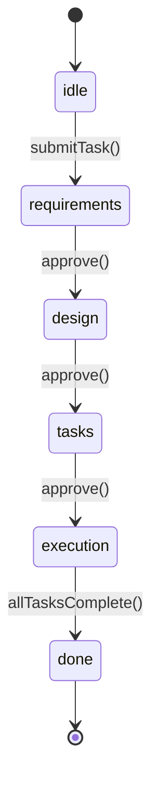

# Design Document — Panther CLI

## Overview

Panther is a self-contained, spec-driven local coding agent distributed as a single npm package. The entire inference stack runs in-process via `node-llama-cpp` bindings — no external server, daemon, or cloud account required. The system is structured around a central agent loop that calls discrete tool executors, wired through a permission gate, and fed context from an in-process RAG index. An optional BYOK layer allows the local model to be swapped for a remote API provider at the session level, all behind a common `ModelProvider` interface.

---

## Architecture

```
panther/
├── src/
│   ├── cli/                 # commander command definitions + ink wizard
│   ├── session/             # session manager, REPL (ink) + one-shot runner
│   ├── spec/                # spec workflow state machine
│   ├── agent/               # agent loop, tool-call dispatch
│   ├── tools/               # read_file, write_file, apply_diff, run_command, etc.
│   ├── inference/           # node-llama-cpp wrapper, model manager
│   ├── providers/           # ModelProvider interface: local + BYOK remote
│   ├── rag/                 # chunker (tree-sitter), embeddings, vector store
│   ├── memory/              # memory.md read/write
│   ├── skills/              # skill discovery, loading, tool registration
│   ├── permissions/         # permission gate logic
│   └── config/              # config file read/write, defaults
├── test/
│   ├── unit/
│   └── integration/         # mocked-model agent loop tests
```

### System Diagram

```
┌────────────────────────────────────────────────────────────────┐
│                       Panther CLI process                        │
│                                                                  │
│  ┌──────────────┐   ┌──────────────────┐   ┌───────────────┐   │
│  │  Session      │   │  SpecWorkflow     │   │  Permission   │   │
│  │  manager      │◄──┤  state machine    │◄──┤  Gate         │   │
│  │  (REPL /      │   │  (req→design→     │   │  (config-     │   │
│  │  one-shot)    │   │  tasks→exec)      │   │  driven)      │   │
│  └──────┬───────┘   └────────┬──────────┘   └───────┬───────┘   │
│         │                    │                       │           │
│         ▼                    ▼                       ▼           │
│  ┌──────────────────────────────────────────────────────────┐   │
│  │              Agent loop (tool-calling core)                │   │
│  └────┬────────────────┬─────────────────┬──────────┬───────┘   │
│       │                │                 │          │            │
│       ▼                ▼                 ▼          ▼            │
│  ┌─────────┐  ┌─────────────┐  ┌──────────┐  ┌──────────┐     │
│  │ Model    │  │ RAG index    │  │  Skills   │  │ Memory   │     │
│  │ Provider │  │ (embed +     │  │  loader   │  │ (.md)    │     │
│  │ (local / │  │  vector db)  │  │ (SKILL.md)│  │          │     │
│  │  BYOK)   │  │              │  │           │  │          │     │
│  └─────────┘  └─────────────┘  └──────────┘  └──────────┘     │
│                                                                  │
│  ┌──────────────────────────────────────────────────────────┐   │
│  │  Tool executors: read_file, write_file, apply_diff,        │   │
│  │  run_command (sandboxed), grep, list_dir, run_tests        │   │
│  └──────────────────────────────────────────────────────────┘   │
└────────────────────────────────────────────────────────────────┘
         │
         ▼
   Local filesystem: project repo, .panther/ (memory.md, skills, index.db, config)
```

---

## Components and Interfaces

### ModelProvider

The single abstraction between the agent loop and the inference backend. The agent loop, spec workflow, and RAG retriever are all provider-agnostic.

```ts
interface ModelProvider {
  readonly name: "local" | "openai" | "anthropic" | "gemini" | "nvidia";
  readonly contextWindow: number;
  readonly supportsGrammar: boolean;
  generate(
    history: Message[],
    tools: ToolSchema[]
  ): AsyncIterable<TokenChunk | ToolCall>;
  embedText?(text: string): Promise<number[]>;
}
```

Provider selection at session start:

```ts
function resolveProvider(
  config: PantherConfig,
  override?: string
): ModelProvider {
  const requested = override ?? config.activeProvider;
  if (requested !== "local" && !credentialStore.has(requested)) {
    throw new Error(
      `No API key configured for ${requested}. Run: panther auth add ${requested}`
    );
  }
  return providerRegistry.get(requested);
}
```

### ToolExecutor

Each tool is an independently testable module. Risk classification is fixed at declaration time — not model-judged.

```ts
interface ToolExecutor {
  name: string;
  riskLevel: "safe" | "risky";
  schema: JSONSchema; // used to build GBNF grammar for local provider
  execute(args: unknown, ctx: SessionContext): Promise<ToolResult>;
}
```

Tool registry:

| Tool | Risk level |
|---|---|
| `read_file` | safe |
| `list_dir` | safe |
| `grep` | safe |
| `run_tests` | safe |
| `write_file` | risky |
| `apply_diff` | risky |
| `run_command` | risky |

### PermissionGate

```ts
type PermissionDecision = "approved" | "denied" | "needs_prompt";

interface PermissionGate {
  check(tool: ToolExecutor, config: PantherConfig): PermissionDecision;
}
```

Decision matrix:

| Mode | Safe tool | Risky tool |
|---|---|---|
| `always_ask` | `needs_prompt` | `needs_prompt` |
| `ask_when_risky` | `approved` | `needs_prompt` |
| `never_ask` | `approved` | `approved` |

In one-shot mode, `needs_prompt` resolves to `denied` automatically with a log entry. In REPL mode, `needs_prompt` displays an Ink `<ApprovalGate>` component.

### Agent Loop

ReAct-style loop. The agent loop is provider-agnostic — it calls `ModelProvider.generate()` and receives normalized `ModelOutput` objects. Tool calling is handled differently per provider:
- **Local (node-llama-cpp v3)**: functions are passed directly to `session.prompt()` via its JSON schema support. node-llama-cpp handles GBNF grammar-constrained generation internally — no manual grammar building required.
- **Remote (BYOK, Phase 6)**: each SDK's native function-calling format is normalized into the same `ModelOutput` shape.

```ts
async function runAgentLoop(task: string, ctx: SessionContext) {
  let history = ctx.loadHistory();
  history.push({ role: "user", content: task });

  while (true) {
    // Provider-agnostic: ctx.model.generate() handles the underlying
    // API (session.prompt + functions for local, SDK calls for remote)
    // and returns AsyncIterable<TokenChunk | ToolCall | CompletionSignal>.
    const response = await ctx.model.generate(history, ctx.availableTools);

    if (response.type === "tool_call") {
      const tool = ctx.getTool(response.toolName);
      const decision = permissionGate.check(tool, ctx.config);

      if (decision === "denied") {
        history.push(userDeclined(tool));
        continue;
      }
      if (decision === "needs_prompt") {
        const approved = await promptUserApproval(tool, response.args, ctx);
        if (!approved) { history.push(userDeclined(tool)); continue; }
      }

      const result = await tool.execute(response.args, ctx);
      history.push(toolResult(result));
      continue;
    }

    if (response.type === "complete") {
      if (ctx.isInteractive) {
        history.push({ role: "assistant", content: response.text });
        const userInput = await getNextUserInput(ctx);
        if (userInput === null) return;
        history.push({ role: "user", content: userInput });
      } else {
        await ctx.memory.appendSessionLog(summarize(history));
        return response.text;
      }
    }
  }
}
```

### SpecWorkflow State Machine

States: `idle → requirements → design → tasks → execution → done`

Transitions require an explicit `approve()` call. Each stage writes its output to `.panther/specs/<spec-id>/<stage>.md` before requesting approval.



### Skill Loading

```ts
// Startup: metadata only
const allSkills = await discoverSkills(ctx.projectRoot);

// Per-task: full body only for matches
async function loadRelevantSkills(task: string, ctx: SessionContext) {
  const matched = allSkills.filter(s => matchesDescription(s, task));
  return Promise.all(matched.map(s => loadSkillBody(s)));
}
```

`SKILL.md` frontmatter schema:

```yaml
---
name: react-component-conventions
description: Use when creating or editing React components in this project
triggers: ["create component", "new component", "*.tsx"]
tools: []  # optional additional ToolExecutors this skill registers
preApproved: false  # set true to bypass permission prompt for skill-registered tools
---
```

---

## Data Models

### PantherConfig

```ts
interface PantherConfig {
  permissionMode: "always_ask" | "ask_when_risky" | "never_ask";
  modelTier: "small" | "large";
  modelFamily: "qwen";
  activeProvider: "local" | "openai" | "anthropic" | "gemini" | "nvidia";
  telemetryOptIn: boolean;
}
```

Stored at `~/.panther/config.json` (global) and `.panther/config.json` (project). Project config values override global defaults.

### Session

```ts
interface Session {
  id: string;
  createdAt: string;       // ISO 8601
  updatedAt: string;       // ISO 8601
  history: Message[];
  specId?: string;
  taskId?: string;
}
```

Stored at `.panther/sessions/<id>.json`.

### ModelManifest

```ts
interface ModelManifest {
  name: string;
  tier: "small" | "large";
  huggingFaceRepo: string;
  filename: string;
  contextWindow: number;
  expectedHash: string;    // SHA-256
}
```

`model-manifest.json` is bundled in the npm package; actual GGUF files live in `~/.panther/models/`.

### RAG Chunk

SQLite schema (`~/.panther/index.db` per project at `.panther/index.db`):

```sql
CREATE TABLE chunks (
  id         INTEGER PRIMARY KEY,
  file_path  TEXT NOT NULL,
  start_line INTEGER NOT NULL,
  end_line   INTEGER NOT NULL,
  content    TEXT NOT NULL,
  embedding  BLOB NOT NULL   -- sqlite-vec float32 vector
);

CREATE TABLE file_index (
  file_path TEXT PRIMARY KEY,
  mtime     INTEGER NOT NULL
);
```

### SkillMeta

```ts
interface SkillMeta {
  name: string;
  description: string;
  triggers: string[];
  tools: string[];
  preApproved: boolean;
  filePath: string;
}
```

---

## Correctness Properties

*A property is a characteristic or behavior that should hold true across all valid executions of a system — essentially, a formal statement about what the system should do. Properties serve as the bridge between human-readable specifications and machine-verifiable correctness guarantees.*

### Property 1: Permission gate covers all tool × mode combinations

*For any* combination of permission mode (`always_ask`, `ask_when_risky`, `never_ask`) and tool risk level (`safe`, `risky`), the PermissionGate SHALL return a decision consistent with the decision matrix — no combination is unhandled or returns an unexpected value.

**Validates: Requirements 9.4, 9.5, 9.6**

---

### Property 2: Config merge preserves precedence

*For any* pair of global config and project config objects (including partially-populated or missing files), the merged result SHALL contain the project-level value for every key present in the project config, and the global value for every key absent from the project config.

**Validates: Requirements 9.2, 9.3**

---

### Property 3: Session round-trip consistency

*For any* session object with arbitrary history, creating it, saving it to disk, and reloading it SHALL produce a session whose `history` field is identical to the original.

**Validates: Requirements 4.6, 5.6**

---

### Property 4: Memory append monotonicity

*For any* initial `memory.md` content and any sequence of `appendSessionLog` calls, each call SHALL add exactly one new dated section, and the total number of sections after N calls SHALL equal the initial count plus N.

**Validates: Requirements 7.3**

---

### Property 5: Skill body loaded only on match

*For any* set of available skills and any task string, `loadRelevantSkills` SHALL load the full body of a skill if and only if the task string matches that skill's `description` or `triggers`. Skills that do not match SHALL NOT have their body read from disk.

**Validates: Requirements 8.3**

---

### Property 6: RAG retrieval is capped within context budget

*For any* set of retrieved chunks and any model context window size, the total token count of chunks injected into the agent prompt SHALL not exceed the configured fraction of the model's `contextWindow`.

**Validates: Requirements 11.6**

---

### Property 7: Agent loop task_complete terminates loop

*For any* conversation history and any sequence of tool-call responses followed by a `task_complete` response, the agent loop SHALL terminate after processing the `task_complete` response and SHALL not issue further tool calls.

**Validates: Requirements 4.1, 4.2**

---

### Property 8: Risky tool one-shot auto-denial

*For any* risky tool and any permission mode other than `never_ask`, when the agent loop runs in one-shot mode and the PermissionGate returns `needs_prompt`, the tool execution SHALL be denied without interactive input and a log entry SHALL be written.

**Validates: Requirements 4.5**

---

### Property 9: Credential never written to config file

*For any* `panther auth add <provider>` invocation with any API key value, the resulting `~/.panther/config.json` and `.panther/config.json` files SHALL not contain the API key string. Credentials are stored via `cross-keychain` (OS-native keychain), not in config files.

**Validates: Requirements 12.3**

---

### Property 10: SpecWorkflow state transitions are strictly ordered

*For any* spec workflow instance, calling `approve()` from state S SHALL advance to state S+1 in the defined order (requirements → design → tasks → execution → done), and no state SHALL be reachable by skipping a predecessor state.

**Validates: Requirements 6.1, 6.3**

---

## Error Handling

### Model load failure
If `node-llama-cpp` fails to load the GGUF file (missing file, corrupted download, incompatible format), the System emits a human-readable error with the model path and suggests running `panther model switch` to re-download.

### Native addon load failure
On `postinstall`, the System validates that all native addons load successfully. If loading fails, it prints a clear error message (not a raw stack trace) identifying which addon failed and how to fix it (e.g., Node version mismatch, missing runtime libraries).

### Tool execution errors
Every `ToolExecutor.execute()` call is wrapped in a try/catch. Errors are returned as structured `ToolResult` objects with `success: false` and a descriptive `error` string. The agent loop appends this error result to history so the model can reason about the failure.

### Remote provider errors (BYOK)
Network errors, rate-limit responses, and authentication failures from remote providers are caught and returned as structured errors to the agent loop. The session surface displays a human-readable summary (e.g., "Rate limited by OpenAI — waiting 30 s before retry").

### Permission denial
When a tool is denied, the agent loop appends a structured "permission denied" message to history so the model knows the action was blocked and can propose an alternative.

### Config file corruption
If a JSON config file cannot be parsed, the System logs a warning, falls back to built-in defaults, and does not crash. The user is advised to run `panther config` to repair the file.

---

## Testing Strategy

### Unit tests (Vitest)

- Config merge logic: all precedence combinations, missing-file fallback, invalid JSON fallback.
- PermissionGate: all 6 mode × risk-level combinations; one-shot auto-denial; pre-approved skill tool bypass.
- Session manager: round-trip create → save → reload preserving full history.
- Memory: `appendSessionLog` produces correct section count; `readMemory` truncates at token budget.
- Skill discovery: 3 temp `SKILL.md` files discovered with correct metadata; lazy-load triggers on match only.
- Tool executors: each tool tested against temp files/dirs; `run_command` rejects path traversal; `apply_diff` patches correctly.
- Agent loop: mocked model returns scripted `read_file → write_file → task_complete` sequence; permission denial path; one-shot auto-denial.
- RAG store: insert 3 chunks, search returns nearest by cosine distance.
- Tree-sitter chunker: TypeScript sample parsed into chunks aligned with function boundaries.

### Property-based tests (Vitest + fast-check)

Property tests run with a minimum of 100 iterations each. Each test is tagged with its design property:

- **Feature: panther-cli, Property 1**: generate random (mode, riskLevel) pairs → PermissionGate returns a valid decision for every combination.
- **Feature: panther-cli, Property 2**: generate random partial global + project config pairs → merged result respects precedence for all keys.
- **Feature: panther-cli, Property 3**: generate sessions with random history arrays → save → reload produces identical history.
- **Feature: panther-cli, Property 4**: generate random initial memory content + N log entries → section count equals initial + N after all appends.
- **Feature: panther-cli, Property 5**: generate random skill sets and task strings → `loadRelevantSkills` loads body if and only if description/triggers match.
- **Feature: panther-cli, Property 6**: generate random chunk sets with token counts → injected context never exceeds the configured budget.
- **Feature: panther-cli, Property 7**: generate random tool-call sequences ending in `task_complete` → loop terminates with no further calls.
- **Feature: panther-cli, Property 8**: generate random risky tools in one-shot mode → all `needs_prompt` cases produce `denied` + log entry.
- **Feature: panther-cli, Property 9**: generate random API keys → after `auth add`, key value absent from all config files.
- **Feature: panther-cli, Property 10**: generate random sequences of `approve()` calls → states advance strictly in order, no skipping.

### Integration tests (mocked model)

Integration tests use a fake `ModelProvider` that returns scripted tool-call sequences. No real model download required in CI.

- Agent loop: end-to-end tool-call sequences completing a multi-step task.
- SpecWorkflow: 3-stage spec (requirements → design → tasks), each stage writing the correct markdown file.
- Execution stage: `tasks.md` with 3 checkbox items — all boxes ticked and memory updated after completion.
- REPL session: simulate user input, assert streaming output rendered by Ink components.

### Golden-file tests

- Requirements stage: fixed task description + mocked model → output parses as structurally valid EARS requirements.
- Design stage: fixed requirements.md + mocked model → design.md contains required section headings.
- Tasks stage: fixed design.md + mocked model → tasks.md contains checkbox items.

### CI matrix

GitHub Actions runs unit + property + integration tests on every PR across: ubuntu-latest, macos-latest, windows-latest × Node 18, Node 20. A separate nightly job runs smoke tests with real model weights on a self-hosted GPU runner.
