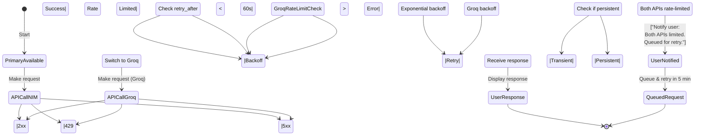
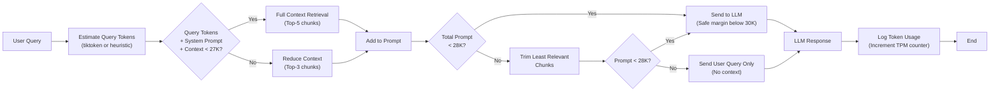
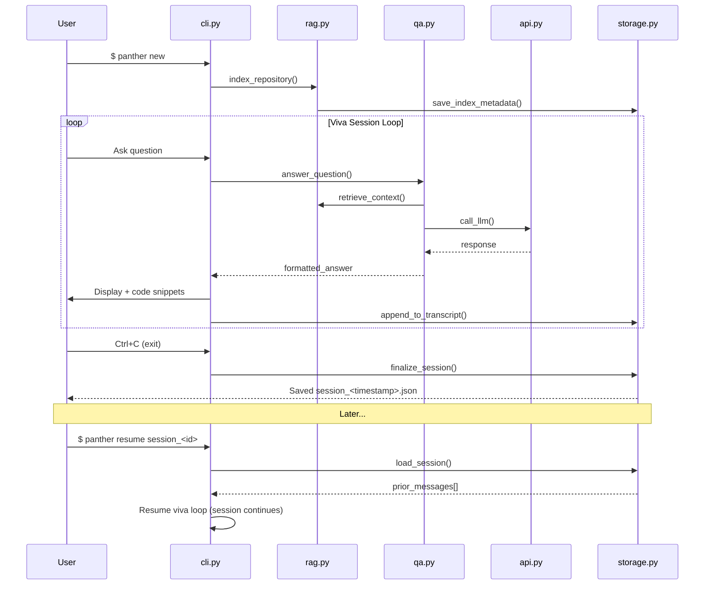

# Panther CLI: Comprehensive Guide
## Product Requirements, System Architecture & Tech Stack

**Version**: v1.0.0b0  
**Status**: Development Ready  
**Last Updated**: August 2026

---

## Table of Contents
1. [Product Requirements Document (PRD)](#product-requirements-document-prd)
2. [System Architecture & Design](#system-architecture--design)
3. [Technology Stack](#technology-stack)
4. [Setup & Installation Guide](#setup--installation-guide)
5. [Implementation Notes](#implementation-notes)

---

# Product Requirements Document (PRD)

## 1. Objective

**Panther CLI** is a free, open-source Python command-line application that transforms any local codebase (Python, SQL, libraries) into an interactive learning environment. Users conduct "viva" sessions—teacher-led, conversational code walkthroughs—with an AI that retrieves and explains specific code functionality on demand.

**Vision**: Make code exploration interactive, educational, and deeply personal by analyzing *your actual codebase*, not generic examples.

---

## 2. Core Features

### **Feature 1: Interactive Viva Sessions**
- User launches `panther` in their project directory
- CLI accepts natural language questions about code (e.g., "Explain the authentication flow in `auth.py`")
- AI retrieves relevant code snippets using RAG, analyzes them, and responds as a teacher
- Conversation history persists locally; users can resume prior sessions

**Tech**: Direct OpenAI-compatible chat client (`requests`) + JSON session transcripts

### **Feature 2: RAG Pipeline (Codebase Ingestion)**
- On first run, Panther recursively scans the repository
- Skips build/cache folders (`.git`, `node_modules`, `__pycache__`, `.venv`)
- Splits code into semantic chunks (500 tokens, 50-token overlap)
- Embeds chunks using `sentence-transformers` (locally, no API calls)
- Stores embeddings in Chroma (persistent, SQLite-backed)

**Tech**: Custom recursive chunker + Chroma + sentence-transformers

### **Feature 3: Free API Integration with Fallback**
- **Primary**: NVIDIA NIM free API (~40 RPM, 100+ models)
- **Fallback**: Groq free API (30 RPM, ultra-fast inference)
- Gracefully switches to Groq if NVIDIA hits 429 (rate limit)
- Logs all API switches; user sees brief notification

**Tech**: OpenAI SDK compatible endpoints, HTTP 429 retry logic

### **Feature 4: Token Budgeting & Rate Limit Handling**
- Before each API call, estimates tokens (heuristic + `tiktoken` optional)
- Enforces 30K tokens/minute soft cap (NVIDIA limit)
- Trims context snippets if needed, never rejects queries
- Shows progress: "Indexing 1,247 files... 45% complete"

**Tech**: `tiktoken` for precise counting, dynamic context sizing

### **Feature 5: Teacher-Centric Viva Tone**
- AI acts as a knowledgeable instructor, not an exam grader
- Asks follow-ups: "Do you understand how this closure works? Try explaining it back to me..."
- Encourages deep learning: "This is a common pattern—where else have you seen it?"
- Celebrates understanding: "Exactly! You've grasped the abstraction."

**Tech**: Custom system prompt, adjustable tone flags

### **Feature 6: Beautiful CLI Aesthetics**
- Custom ASCII banner with gradient red→orange rendering (character-by-character interpolation)
- Progress spinners for indexing
- Syntax-highlighted code snippets in responses
- Clean, readable conversation layout

**Tech**: `rich.text.Text` for gradient, `rich.console.Console` for rendering

---

## 3. User Stories

### **Story 1: Onboarding a New Developer**
> As a junior engineer, I want to explore an unfamiliar codebase interactively so I can understand the architecture without reading docs or bothering teammates.

**Flow**: 
1. `panther` → indexes repo
2. "What's the main data pipeline?" → AI explains flow with code snippets
3. "Show me how the database layer works" → AI drills into SQL queries
4. Saves transcript for later review

---

### **Story 2: Debugging a Complex Feature**
> As a developer, I want to ask Panther specific questions about a module's behavior so I can trace bugs faster.

**Flow**:
1. `panther resume session-2024-08-15` → loads prior viva
2. "I'm seeing a null pointer in `auth.py`. Walk me through the logic."
3. AI retrieves `auth.py`, explains edge cases, suggests test cases
4. Developer updates code, re-indexes, and re-tests with Panther

---

### **Story 3: Teaching Code to Others**
> As a tech lead, I want to use Panther to guide junior devs through the codebase interactively.

**Flow**:
1. Launch `panther --shared-session`
2. Junior asks questions; Panther explains with live code
3. Session saved for asynchronous learning
4. Junior references same explanations later

---

## 4. User Flow (Detailed)

```
┌─────────────────────────────────────────────────────────────┐
│                   PANTHER CLI USER FLOW                     │
├─────────────────────────────────────────────────────────────┤
│                                                              │
│  1. USER LAUNCHES                                            │
│     $ panther                                                │
│                                                              │
│  2. FIRST RUN: INDEX REPO                                    │
│     ├─ Scan filesystem (skip build folders)                 │
│     ├─ Read source files (Python, SQL, libraries)           │
│     ├─ Chunk & embed (sentence-transformers)                │
│     ├─ Store in Chroma (persist ~/.panther/db/)             │
│     └─ [Progress bar: "1,247 files indexed ✓"]              │
│                                                              │
│  3. DISPLAY BANNER                                           │
│     ╔════════════════════════════════════════╗              │
│     ║  PANTHER CLI [Red→Orange Gradient]     ║              │
│     ║  v1.0.0b0 | AI Repository Analyzer ║              │
│     ╚════════════════════════════════════════╝              │
│                                                              │
│  4. ENTER VIVA MODE                                          │
│     User prompt: "Explain the auth module"                  │
│                                                              │
│  5. RAG RETRIEVAL                                            │
│     ├─ Embed query → search Chroma                          │
│     ├─ Retrieve top-5 relevant code chunks                  │
│     └─ Build prompt: system + context + query               │
│                                                              │
│  6. API CALL (with Fallback)                                 │
│     ├─ Primary: POST to NVIDIA NIM endpoint                 │
│     ├─ If 429 error → Retry with exponential backoff        │
│     ├─ If persistent failure → Switch to Groq               │
│     └─ Return AI response (teacher-like tone)               │
│                                                              │
│  7. RENDER RESPONSE                                          │
│     ├─ Full-screen chat UI: transcript + fixed bottom input │
│     ├─ @file mentions attach code; /commands, Tab-complete │
│     ├─ Display conversation (user Q + AI A)                 │
│     ├─ Show referenced code snippets (syntax highlight)     │
│     ├─ Log to session transcript (~/.panther/sessions/)     │
│     └─ Prompt for next question                             │
│                                                              │
│  8. MULTI-TURN LOOP                                          │
│     └─ Repeat 4–7 until user exits (Ctrl+C)                 │
│                                                              │
│  9. SESSION PERSISTENCE                                      │
│     └─ Save to JSON: session_YYYY-MM-DD_HHMMSS.json         │
│        (Can resume with: $ panther resume <session-id>)     │
│                                                              │
└─────────────────────────────────────────────────────────────┘
```

---

# System Architecture & Design

## 1. Architecture Overview

```
┌────────────────────────────────────────────────────────────────┐
│                    PANTHER CLI ARCHITECTURE                    │
├────────────────────────────────────────────────────────────────┤
│                                                                │
│  ┌──────────────────────────────────────────────────────────┐ │
│  │  CLI INTERFACE LAYER (cli.py)                            │ │
│  │  ├─ Argument parsing (argparse)                          │ │
│  │  ├─ Session management (new, resume, list)              │ │
│  │  ├─ User input/output loop                              │ │
│  │  └─ Graceful shutdown handling                          │ │
│  └──────────────────────────────────────────────────────────┘ │
│                           ↓                                   │
│  ┌──────────────────────────────────────────────────────────┐ │
│  │  INDEXING ENGINE (rag.py)                                │ │
│  │  ├─ Filesystem scanner (recursive, with ignore patterns) │ │
│  │  ├─ File reader (Python, SQL, text)                     │ │
│  │  ├─ Chunker (custom recursive, code-aware)             │ │
│  │  ├─ Embedder (sentence-transformers)                    │ │
│  │  └─ Chroma writer (persist locally)                     │ │
│  └──────────────────────────────────────────────────────────┘ │
│                           ↓                                   │
│  ┌──────────────────────────────────────────────────────────┐ │
│  │  RETRIEVAL & QA LAYER (qa.py)                            │ │
│  │  ├─ Query embedding (sentence-transformers)             │ │
│  │  ├─ Chroma similarity search                            │ │
│  │  ├─ Prompt construction (system + context + user Q)      │ │
│  │  ├─ Token budgeting (tiktoken, heuristic)               │ │
│  │  └─ Context trimming (if over budget)                   │ │
│  └──────────────────────────────────────────────────────────┘ │
│                           ↓                                   │
│  ┌──────────────────────────────────────────────────────────┐ │
│  │  API CLIENT & FALLBACK (api.py)                          │ │
│  │  ├─ NVIDIA NIM client (40 RPM free tier)                │ │
│  │  ├─ Groq client (30 RPM free tier, fallback)            │ │
│  │  ├─ Rate limit tracking & exponential backoff           │ │
│  │  ├─ API key rotation (if future enterprise keys)        │ │
│  │  └─ Error handling & logging                            │ │
│  └──────────────────────────────────────────────────────────┘ │
│                           ↓                                   │
│  ┌──────────────────────────────────────────────────────────┐ │
│  │  UI & RENDERING (ui.py)                                 │ │
│  │  ├─ Gradient banner (red → orange)                       │ │
│  │  ├─ Progress spinners & bars                            │ │
│  │  ├─ Syntax-highlighted code blocks (Pygments)           │ │
│  │  ├─ Conversation rendering                              │ │
│  │  └─ Error & status messages                             │ │
│  └──────────────────────────────────────────────────────────┘ │
│                           ↓                                   │
│  ┌──────────────────────────────────────────────────────────┐ │
│  │  PERSISTENT STORAGE (~/.panther/)                        │ │
│  │  ├─ db/: keyword index + Chroma vector store            │ │
│  │  ├─ config.json: User settings + API keys               │ │
│  │  └─ sessions/: Session transcripts (JSON)               │ │
│  └──────────────────────────────────────────────────────────┘ │
│                                                                │
└────────────────────────────────────────────────────────────────┘
```

---

## 2. Modular File Tree

```
panther/
├── README.md                      # Quick start, examples
├── LICENSE                        # Open source (MIT or Apache 2.0)
├── pyproject.toml                 # Poetry/pip config + dependencies
├── requirements.txt               # Pinned versions
│
├── panther/                       # Main package
│   ├── __init__.py               # Version, exports
│   ├── __main__.py               # Entry point (cli.py delegation)
│   │
│   ├── cli.py                    # CLI interface & session management
│   │   ├── main()                # argparse setup, subcommands
│   │   ├── cmd_init()            # Initialize ~/.panther/
│   │   ├── cmd_index()           # Manual re-index repo
│   │   ├── cmd_new()             # Start new viva session
│   │   ├── cmd_resume()          # Resume from session ID
│   │   ├── cmd_list()            # List all saved sessions
│   │   └── viva_loop()           # Main interaction loop
│   │
│   ├── rag.py                    # Indexing & retrieval engine
│   │   ├── RepoScanner           # Filesystem traversal
│   │   ├── CodeChunker           # Text splitting logic
│   │   ├── EmbeddingPipeline     # sentence-transformers wrapper
│   │   ├── ChromaStore           # Chroma DB interface
│   │   └── index_repository()    # Orchestrator
│   │
│   ├── qa.py                     # Query answering & context building
│   │   ├── QueryExpander         # Enhance user query
│   │   ├── ContextRetriever      # Chroma search + ranking
│   │   ├── PromptBuilder         # Construct LLM prompt
│   │   ├── TokenBudgeter         # Estimate & trim context
│   │   └── answer_question()     # Main QA orchestrator
│   │
│   ├── api.py                    # LLM API clients & fallback
│   │   ├── NIMClient             # NVIDIA NIM wrapper
│   │   ├── GroqClient            # Groq wrapper
│   │   ├── APIFallbackManager    # 429 error handling, fallback logic
│   │   ├── RateLimiter           # Track RPM/TPM
│   │   └── call_llm()            # Main interface (auto-fallback)
│   │
│   ├── ui.py                     # Terminal UI & aesthetics
│   │   ├── GradientBanner        # Red→Orange ASCII art
│   │   ├── ProgressBar           # Indexing progress
│   │   ├── CodeHighlighter       # Syntax highlight with Pygments
│   │   ├── ConversationRenderer  # Format viva chat
│   │   └── render_*()            # Individual components
│   │
│   ├── config.py                 # Configuration management
│   │   ├── ConfigManager         # YAML load/save
│   │   ├── get_config()          # Global settings
│   │   └── init_panther_home()   # Setup ~/.panther/
│   │
│   └── storage.py                # Session persistence
│       ├── SessionManager        # Load/save JSON transcripts
│       ├── save_session()        # Write to disk
│       └── load_session()        # Resume from file
│
├── tests/                         # Unit & integration tests
│   ├── test_rag.py              # RAG pipeline tests
│   ├── test_qa.py               # QA orchestration tests
│   ├── test_api.py              # API client & fallback tests
│   └── test_ui.py               # UI rendering tests
│
└── docs/                         # Extended documentation
    ├── ARCHITECTURE.md           # Detailed design notes
    ├── API_SETUP.md              # NVIDIA NIM & Groq setup
    └── EXAMPLES.md               # Usage scenarios & transcripts
```

---

## 3. Mermaid Diagrams

### **3.1 RAG Data Flow**

```mermaid
graph TD
    A["User launches panther<br/>(First Run)"] -->|1. Scan| B["RepoScanner<br/>(Traverse filesystem)"]
    B -->|2. Read files| C["Code Files<br/>(Python, SQL, .txt)"]
    C -->|3. Filter| D["Skip .git, node_modules,<br/>__pycache__, .venv"]
    D -->|4. Split| E["CodeChunker<br/>(500 tokens, 50 overlap)"]
    E -->|5. Embed| F["sentence-transformers<br/>all-MiniLM-L6-v2"]
    F -->|6. Store| G["Chroma DB<br/>(SQLite, ~/.panther/db/)"]
    G -->|[Index complete ✓]| H["Viva Session Ready"]
    
    H -->|User Query| I["QueryExpander<br/>(Enhance query)"]
    I -->|Embed Query| J["sentence-transformers"]
    J -->|Similarity Search| K["Chroma Retrieval<br/>(Top-5 chunks)"]
    K -->|Retrieved Context| L["PromptBuilder<br/>(system + context + Q)"]
    L -->|Token Budget Check| M["TokenBudgeter<br/>(tiktoken, ~30K cap)"]
    M -->|Trim if needed| N["Final Prompt"]
    N -->|API Call| O["LLM Response<br/>(NVIDIA NIM or Groq)"]
    O -->|Response| P["ConversationRenderer<br/>(Format + highlight)"]
    P -->|Display| Q["User sees answer<br/>+ code snippets"]
    Q -->|Log| R["Session Transcript<br/>(~/.panther/sessions/)"]
    R -->|Next question| I
```

---

### **3.2 API Fallback State Machine**



---

### **3.3 Token Budgeting Logic**



---

### **3.4 Session Lifecycle**



---

## 4. Edge Cases & Error Handling

| **Edge Case** | **Scenario** | **Handling** |
|---|---|---|
| Large Repo (>10K files) | Indexing takes >5min | Show progress bar; allow background re-index |
| Empty Query | User presses Enter without text | Prompt: "Ask something! E.g., 'Explain the data model.'" |
| Context Too Long | Retrieved chunks exceed 27K tokens | Token budgeter trims iteratively; never rejects Q |
| Both APIs Rate Limited | NVIDIA & Groq both at 429 | Queue request; retry in 5 min; user notified |
| Missing `.panther/` | User runs without initialization | Auto-create on first run; no manual setup needed |
| Corrupted Session File | Prior session JSON is invalid | Warn user; start fresh session |
| Network Unavailable | No internet connection | Graceful error; suggest retry offline capability (future) |
| Non-Python Code | User has Java/Go in repo | Parse gracefully; skip unknown types; explain in logs |

---

# Technology Stack

## 1. Core Dependencies

### **Backend & RAG**
| Package | Version | Purpose |
|---------|---------|---------|
| `requests` | ≥2.31 | OpenAI-compatible HTTP client for NVIDIA NIM + Groq |
| `python-dotenv` | ≥1.0 | Load `.env` files for API keys |
| `chromadb` | ≥0.5.0 | Vector storage (local, persistent, SQLite) |
| `sentence-transformers` | ≥3.0.0 | Embeddings (all-MiniLM-L6-v2) |
| `tiktoken` | ≥0.7.0 | Token counting for budgeting |

### **CLI & UI**
| Package | Version | Purpose |
|---------|---------|---------|
| `rich` | ≥13.0 | Terminal rendering (colors, progress, tables) |
| `argparse` | (stdlib) | CLI command surface (init, index, new, resume, auth, config) |
| `Pygments` | ≥2.15 | Syntax highlighting for code blocks |

### **Utilities**
| Package | Version | Purpose |
|---------|---------|---------|
| `pydantic` | ≥2.0 | Config validation & data models |
| `python-dotenv` | ≥1.0 | Load `.env` files for API keys |
| `requests` | ≥2.31 | HTTP client for all API calls |

### **Optional (for Production)**
| Package | Version | Purpose |
|---------|---------|---------|
| `cryptography` | ≥41.0 | Encrypt API keys at rest (future) |
| `python-dateutil` | ≥2.8 | Date parsing for session management |

---

## 2. Python Version & Virtual Environment

- **Min Python**: 3.9  
- **Recommended**: 3.11+  
- **Virtual Env**: venv, Poetry, or uv  

---

## 3. External API Credentials

### **NVIDIA NIM Free Tier**
- **Endpoint**: `https://integrate.api.nvidia.com/v1/chat/completions`  
- **Sign-up**: [build.nvidia.com](https://build.nvidia.com)  
- **Rate Limit**: ~40 RPM (requests/min), no daily cap  
- **API Key Format**: Starts with `nvapi-`  
- **Models**: Llama 3.1 70B, Nemotron-3-Super, MiniMax M2.7, DeepSeek, etc.

### **Groq Free Tier (Fallback)**
- **Endpoint**: `https://api.groq.com/openai/v1/chat/completions`  
- **Sign-up**: [console.groq.com](https://console.groq.com)  
- **Rate Limit**: 30 RPM, 6K TPM, 14,400 RPD  
- **API Key Format**: Starts with `gsk_`  
- **Models**: Llama 3.3 70B, Llama 3.1 8B, Mixtral 8x7B  

---

## 4. Storage & Data Structures

### **Local Storage Locations**

```
~/.panther/
├── config.json                   # User settings + API keys (api_keys section)
├── db/
│   ├── index.json                # Keyword index (files + snippets)
│   └── chroma/                   # Chroma vector store (SQLite)
└── sessions/
    ├── session_20240815_143022.json
    └── session_20240816_091543.json
```

### **Session Transcript Format (JSON)**

```json
{
  "session_id": "session_2024-08-15_143022",
  "created_at": "2024-08-15T14:30:22Z",
  "repo_path": "/home/user/my-project",
  "repo_name": "my-project",
  "messages": [
    {
      "role": "user",
      "content": "Explain the authentication flow",
      "timestamp": "2024-08-15T14:30:30Z"
    },
    {
      "role": "assistant",
      "content": "Your codebase uses JWT-based auth. Here's how it works...",
      "model_used": "nvidia/nemotron-3-super-120b-a12b",
      "retrieved_chunks": [
        {
          "file": "auth/jwt_handler.py",
          "lines": "45-78",
          "relevance": 0.92
        }
      ],
      "tokens_used": {"prompt": 856, "completion": 412},
      "timestamp": "2024-08-15T14:30:42Z"
    },
    ...
  ],
  "stats": {
    "total_messages": 12,
    "total_tokens_used": 18430,
    "api_calls": {"nvidia_nim": 10, "groq": 2},
    "duration_minutes": 15
  }
}
```

---

# Setup & Installation Guide

## 1. Prerequisites

- Python 3.9+ installed
- Internet connection (for API calls)
- ~500 MB disk space (~50 MB code + Chroma index)
- API keys (free):
  - NVIDIA NIM: [build.nvidia.com](https://build.nvidia.com) (5 min signup)
  - Groq: [console.groq.com](https://console.groq.com) (2 min signup)

---

## 2. Installation Steps

### **Step 1: Install Panther**

```bash
# From PyPI (once published)
pip install panther-cli

# OR from GitHub (development)
git clone https://github.com/<org>/panther.git
cd panther
pip install -e .
```

### **Step 2: Initialize Panther**

```bash
panther init
```

**What this does:**
- Creates `~/.panther/` directory structure
- Writes `~/.panther/config.json` with defaults (API keys are added separately via `panther auth add`)
- Shows setup confirmation

**Example interaction:**

```
╔════════════════════════════════════════════════╗
║  Panther CLI Setup                            ║
╚════════════════════════════════════════════════╝

✓ Creating ~/.panther/ directory...
✓ Config written to ~/.panther/config.json

Next, add your free API keys:
  $ panther auth add nvidia_nim   # free key from https://build.nvidia.com
  $ panther auth add groq         # optional fallback: https://console.groq.com

Then navigate to your project and run:
  $ panther new
```

### **Step 3: Index Your Repository**

```bash
cd /path/to/your/python-project
panther new
```

**What this does:**
- Scans your repo (skips `.git`, `node_modules`, etc.)
- Splits code into 500-token chunks
- Generates embeddings (sentence-transformers, local)
- Stores in Chroma DB (~/.panther/db/)
- Shows progress: "Indexing 1,247 files... 94% complete"

**Expected output:**

```
╔════════════════════════════════════════════════╗
║  Panther CLI - Starting Viva Session          ║
╚════════════════════════════════════════════════╝

📂 Repository: /home/user/my-project
🔍 Scanning...
   • Found 1,247 Python files
   • Found 23 SQL files
   • Skipped: .git/, node_modules/, __pycache__/, .venv/

⚙️  Indexing & Embedding...
   ████████████████████░ 94% | 1,156 chunks processed

✓ Index ready! (Stored in ~/.panther/db/)

━━━━━━━━━━━━━━━━━━━━━━━━━━━━━━━━━━━━━━━━━━━━━━━

🐾 PANTHER CLI [Red→Orange Gradient Banner]
[ v1.0.0b0 | AI Repository Analyzer ]

━━━━━━━━━━━━━━━━━━━━━━━━━━━━━━━━━━━━━━━━━━━━━━━

👨‍🏫 Ready to learn! Ask me anything about your code.

Type 'help' for commands, 'exit' to quit.

You: _
```

### **Step 4: Ask Questions (Viva Mode)**

```bash
You: Explain the database connection pooling strategy

🐾: Your codebase uses SQLAlchemy's QueuePool with the following config:

[Retrieved Code]
────────────────────────────────────────────────
📄 database/connection.py (lines 12-45)
────────────────────────────────────────────────
engine = create_engine(
    DATABASE_URL,
    poolclass=QueuePool,
    pool_size=5,           # Max connections in pool
    max_overflow=10,       # Connections beyond pool_size
    pool_pre_ping=True,    # Check connection health
)
────────────────────────────────────────────────

[Teacher Explanation]
This is a smart pattern! Here's why:

1. **pool_size=5**: Maintains 5 persistent connections
2. **max_overflow=10**: Allows spikes up to 15 concurrent users
3. **pool_pre_ping=True**: Prevents "lost connection" errors

This scales well for your app. Do you understand why 
pool_pre_ping is important? It's a critical defensive technique.

You: _
```

---

## 3. Configuration

### **File**: `~/.panther/config.json` (JSON)

```json
{
  "llm": {
    "primary": {
      "provider": "nvidia_nim",
      "model": "nvidia/nemotron-3-super-120b-a12b",
      "temperature": 0.7,
      "max_tokens": 2048
    },
    "fallback": {
      "provider": "groq",
      "model": "llama-3.1-70b-versatile",
      "temperature": 0.7,
      "max_tokens": 2048
    }
  },
  "retrieval": {
    "embedding_model": "all-MiniLM-L6-v2",
    "chunk_size": 500,
    "chunk_overlap": 50,
    "top_k_chunks": 5,
    "similarity_threshold": 0.25
  },
  "token_budget": {
    "soft_limit_tpm": 30000,
    "max_prompt_tokens": 28000,
    "token_counter": "tiktoken"
  },
  "indexing": {
    "ignore_patterns": [".git", "node_modules", "__pycache__", ".venv", ".panther", "build", "dist", ".idea"],
    "file_extensions": [".py", ".sql", ".txt", ".md", ".toml", ".yaml", ".yml", ".json"]
  },
  "ui": {
    "gradient_enabled": true,
    "verbose_logging": false,
    "show_token_counts": true,
    "theme": "dark"
  },
  "storage": {
    "panther_home": "~/.panther",
    "db_type": "chroma",
    "session_format": "json"
  },
  "api_keys": {
    "nvidia_nim": null,
    "groq": null
  }
}
```

### **Environment Variables (Alternative)**

```bash
# .env file (recommended for security)
NVIDIA_NIM_API_KEY=nvapi-...
GROQ_API_KEY=gsk_...
PANTHER_CHUNK_SIZE=500
PANTHER_VERBOSE=false
```

---

## 4. Common Commands

```bash
# Start a new session for your project
panther new

# List all saved sessions
panther list

# Resume a prior session
panther resume session_2024-08-15_143022

# Manually re-index your repository
panther index

# Delete a session
panther delete session_2024-08-15_143022

# Show current config
panther config show

# Reset everything (caution!)
panther reset --confirm
```

---

# Implementation Notes

## 1. Custom Gradient Banner Implementation

The CLI displays a beautiful red→orange gradient banner on startup. Here's the exact implementation:

```python
from rich.console import Console
from rich.text import Text

console = Console()

banner_text = """
██████╗  █████╗ ███╗   ██╗████████╗██╗  ██╗███████╗██████╗      ██████╗ ██╗     ██╗       ██╗  ██╗  ██╗
██╔══██╗██╔══██╗████╗  ██║╚══██╔══╝██║  ██║██╔════╝██╔══██╗    ██╔════╝ ██║     ██║      ██╔╝ ██╔╝ ██╔╝
██████╔╝███████║██╔██╗ ██║   ██║   ███████║█████╗  ██████╔╝    ██║      ██║     ██║     ██╔╝ ██╔╝ ██╔╝
██╔═══╝ ██╔══██║██║╚██╗██║   ██║   ██╔══██║██╔══╝  ██╔══██╗    ██║      ██║     ██║    ██╔╝ ██╔╝ ██╔╝
██║     ██║  ██║██║ ╚████║   ██║   ██║  ██║███████╗██║  ██║    ╚██████╗ ███████╗██║   ██╔╝ ██╔╝ ██╔╝ 
╚═╝     ╚═╝  ╚═╝╚═╝  ╚═══╝   ╚═╝   ╚═╝  ╚═╝╚══════╝╚═╝  ╚═╝     ╚═════╝ ╚══════╝╚═╝   ╚═╝  ╚═╝  ╚═╝  
                    [ v1.0.0b0 | AI Repository Analyzer ]
"""

lines = banner_text.strip("\n").split("\n")
gradient_text = Text()

for line in lines:
    for i, char in enumerate(line):
        # Calculate gradient ratio (left to right)
        ratio = i / max(1, len(line) - 1)
        # Interpolate from #ff0000 (red) to #ff8c00 (orange)
        # Red: #ff0000, Orange: #ff8c00
        # So we go from 00 green to 8c green as we move right
        green_val = int(ratio * 140)  # 0x8c = 140 in decimal
        hex_color = f"#ff{green_val:02x}00"
        gradient_text.append(char, style=f"bold {hex_color}")
    gradient_text.append("\n")

console.print(gradient_text)
```

**How it works:**
1. For each line in the banner, iterate character by character
2. Calculate position ratio (0.0 = leftmost, 1.0 = rightmost)
3. Interpolate green channel: `0` (red) → `140` (orange)
4. Construct hex color (#ff{green:02x}00)
5. Apply bold style with color to each character
6. Render with rich.Console

**Result**: Smooth, animated-looking left-to-right gradient from pure red to pure orange. ✨

---

## 2. RAG Pipeline: Key Design Decisions

### **Chunking Strategy**
- **Why 500 tokens?** Sweet spot for code: enough context for methods/functions, small enough for precise retrieval
- **Why 50-token overlap?** Prevents context loss between chunks (especially for multi-line functions)
- **Recursive splitting**: the custom chunker splits on `\n\n`, then `\n`, then ` `, then character (syntax-aware, code-friendly)

### **Embedding Model**
- **all-MiniLM-L6-v2**: Lightweight (22M params), fast, 384-dim embeddings, trained on 215M+ query-document pairs
- **No API calls**: Runs locally on CPU, zero latency
- **Trade-off**: Slightly lower quality than larger models (e.g., all-mpnet-base-v2), but perfectly adequate for code

### **Similarity Search**
- **Top-5 chunks**: Balances coverage vs. prompt length
- **Similarity threshold**: 0.25 (adjustable)
- **Re-ranking future**: Could add cross-encoder for better relevance

---

## 3. Token Budgeting: Calculations

```
Maximum tokens per request (NVIDIA NIM):
  • Soft limit: 30,000 tokens/minute
  • Typical request: ~1,000 tokens (modest query + 3-4 chunks)
  • Typical response: ~500 tokens
  • Total per request: ~1,500 tokens
  • Requests per minute safe budget: 30,000 / 1,500 = 20 requests/min
  • Actual NVIDIA limit: ~40 RPM (so we have headroom!)

Token budgeting algorithm:
  1. Estimate user query: len(query) / 4 tokens (heuristic)
  2. System prompt: ~400 tokens (viva teacher role)
  3. Context budget: 28,000 - 400 - est_query - 2,000 buffer
  4. Retrieve top-5 chunks; estimate total tokens
  5. If total > context budget:
     - Remove lowest-relevance chunk
     - Re-estimate; if still over, remove another
     - Continue until under budget (or context_budget = 0)
  6. Send prompt to LLM
  7. Log actual tokens used (for better future estimates)
```

---

## 4. API Fallback: Decision Tree

```python
def call_llm(prompt, model="primary"):
    """
    Call LLM with automatic fallback.
    
    Primary: NVIDIA NIM
    Fallback: Groq (if NIM returns 429 or 5xx)
    """
    
    try:
        response = call_nvidia_nim(prompt)
        log_api_call("nvidia_nim", True)
        return response
    
    except RateLimitError as e:
        # 429: Too Many Requests
        log.warning(f"NVIDIA NIM rate limited: {e}")
        
        if should_retry(e.retry_after):
            # Exponential backoff: 1s, 2s, 4s, 8s, ...
            # Max 5 retries, max 60s total wait
            response = retry_with_backoff(call_nvidia_nim, max_retries=5)
            if response:
                return response
        
        # Switch to Groq
        log.info("Switching to Groq fallback...")
        try:
            response = call_groq(prompt)
            log_api_call("groq", True)
            user_notify("Using Groq (faster inference)")
            return response
        except Exception as e:
            log.error(f"Groq also failed: {e}")
            # Both APIs exhausted
            queue_request(prompt)
            user_notify("Both APIs rate-limited. Request queued.")
            return None
    
    except ServerError as e:
        # 5xx: Server error
        log.error(f"NVIDIA NIM server error: {e}")
        # Try Groq immediately
        try:
            response = call_groq(prompt)
            log_api_call("groq", True)
            return response
        except Exception:
            log.error("Groq also failed")
            return None
```

---

## 5. Session Persistence: Resume Logic

```python
def resume_session(session_id):
    """
    Resume a prior viva session, reconstructing context.
    """
    
    # Load session JSON
    session = SessionManager.load(session_id)
    
    # Reconstruct conversation history
    prior_messages = session.messages  # All prior Q&A pairs
    
    # Initialize LLM with prior context
    # (Groq & OpenAI SDK support 'messages' parameter for context)
    llm_context = [
        {"role": msg["role"], "content": msg["content"]}
        for msg in prior_messages
    ]
    
    # Show recap to user
    console.print(f"\n📖 Resuming session from {session.created_at}")
    console.print(f"   {len(prior_messages)} prior messages")
    console.print(f"   Tokens used: {session.stats.total_tokens_used:,}\n")
    
    # Re-enter viva loop
    # (LLM has full conversation history, can reference prior Q&A)
    return viva_loop(session.messages, session_id=session_id)
```

---

## 6. Agent Tools & Animations

### **Agent Tools (shipped)**

Panther can inspect the codebase while answering by calling safe, read-only
agent tools (`panther/tools.py`):

| Tool | Description | Safety |
|---|---|---|
| `read_file` | Read a text file (relative to the project root) | Path-constrained; no writes |
| `list_dir` | List a directory's contents | Path-constrained |
| `grep` | Regex search across project text files | Read-only |
| `run_tests` | Run `unittest`/`pytest` (project-scoped) | Test commands only; 120s timeout |

The tool-calling loop lives in `panther/agent.py`: the model requests tools via
OpenAI-compatible function calling, Panther executes them locally, feeds results
back, and repeats until a final answer (bounded by `tools.max_turns`, default 6).
Toggle with `/tools` in a session; disable via `"tools": {"enabled": false}`.

### **Reranking (shipped)**

Optional retrieval reranking with a local cross-encoder
(`cross-encoder/ms-marco-MiniLM-L6-v2`) improves precision by re-scoring the
top candidates against the query. Enable with `"rerank": true` under
`retrieval` in `~/.panther/config.json`. It degrades gracefully: if the model
isn't available yet, the original retrieval order is used.

### **Animations (shipped)**

- Loading spinners during retrieval, indexing and embedding (`rich.Status`)
- Typewriter text-fill for answers (visible "typing" effect; falls back to a
  single print when not a TTY)
- Live tool-call feedback: each tool runs under a spinner and shows `✓`/`✗`
- Streamed markdown with syntax highlighting and a blinking cursor
- Full-screen chat TUI (`prompt_toolkit`) on interactive terminals: scrollable
  transcript, input bar pinned to the bottom, `@file` mentions with
  tab-completion, and a `/` command palette; classic REPL for piped input

---

## 7. Future Enhancements (v2.0+)

- [ ] **Multi-language support**: JavaScript, Go, Java, Rust (expand file parser)
- [ ] **Encrypted API keys**: Use `cryptography` to encrypt keys at rest
- [ ] **Offline mode**: Cache embeddings/responses; work without internet (limited)
- [ ] **Custom system prompts**: Let users define viva tone/personality
- [ ] **Local LLM option**: Ollama integration for privacy-first users
- [ ] **Web UI**: Flask/FastAPI for browser-based viva
- [ ] **Multimodal**: Handle images in notebooks, docs
- [ ] **Code execution**: Safe, sandboxed code snippet execution for demos
- [ ] **Team sharing**: Share session transcripts, indexed repos with teammates

---

## 7. Testing Strategy

### **Unit Tests** (`tests/test_*.py`)
- RAG: chunking, embedding, retrieval correctness
- QA: prompt building, token counting accuracy
- API: fallback logic, rate limit handling
- UI: gradient rendering, formatting

### **Integration Tests**
- End-to-end: index repo → ask question → get response
- API fallback: simulate 429 errors, verify Groq switches
- Session: save → resume → verify history

### **Manual Testing Checklist**
- [ ] First-run setup (init, index small repo)
- [ ] Viva session (ask 5+ questions)
- [ ] Session resume (load prior session, continue)
- [ ] API fallback (manually rate-limit NIM, verify Groq activation)
- [ ] Large repo (>5K files; verify progress bar, performance)
- [ ] Edge cases: empty query, malformed session JSON, network unavailable

---

# Deployment & Distribution

## Publishing to PyPI

```bash
# Build
python -m build

# Upload
python -m twine upload dist/*

# Install (users)
pip install panther-cli
```

## GitHub Releases

```bash
# Tag version
git tag v1.0.0b0

# Create release
gh release create v1.0.0b0 --generate-notes
```

---

# License & Contribution

- **License**: MIT or Apache 2.0 (TBD)
- **Contributing**: See CONTRIBUTING.md
- **Bug Reports**: GitHub Issues
- **Security**: security@panther-cli.dev (for responsible disclosure)

---

# Quick Reference

## Installation
```bash
pip install panther-cli
panther init
```

## Usage
```bash
panther new                    # Start new session
panther resume <session-id>    # Continue prior session
panther list                   # Show all sessions
panther index                  # Re-index repo
```

## Keyboard Shortcuts (in viva mode)
| Key | Action |
|-----|--------|
| `Ctrl+C` | Exit & save session |
| `Ctrl+D` | Exit without saving |
| `↑/↓` | Scroll chat history |
| `/help` | Show help commands |
| `/clear` | Clear screen |
| `/api` | Show current API (NIM or Groq) |

---

**Questions?** See `docs/` folder or GitHub Issues.

**Happy Learning! 🐾**

---

*Panther CLI v1.0.0b0 — AI Repository Analyzer for Python & SQL Codebases*